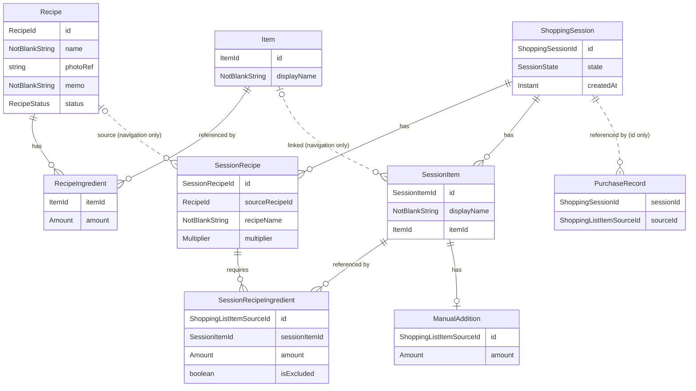

# Recipe-Deck アーキテクチャ

このファイルは Recipe-Deck の設計・技術構成の正本です。
仕様については [spec.md](spec.md) を参照してください。
設計に関わる変更をした PR では、このファイルも同じ PR で更新します。

## 技術構成

確定事項：

- Compose Multiplatform・Kotlin Multiplatform・Ktor を採用する
- マルチモジュール構成
- アーキテクチャは DDD の設計思想を取り入れた、クリーンアーキテクチャに基づく MVVM パターン

未確定：

- Room KMP・Metro・Ktor Client などのライブラリ選定
- Ktor サーバーの役割（重複判定のモデルをサーバーで推論する案がある。[AI / ML](#ai--ml)）

## モジュール構成

| モジュール | 内容 |
|---|---|
| `:app` | Android アプリ。現状は Android Studio の雛形のままで、`:shared:domain` には依存していない。CMP の構成への移行は未着手 |
| `:shared:domain` | ドメイン層の KMP モジュール。ターゲットは JVM・iosArm64・iosSimulatorArm64。パッケージは `amount` / `item` / `recipe` / `shopping`。Repository の interface もここに置く |
| `:shared:usecase` | UseCase の KMP モジュール。`:shared:domain` に依存し、ターゲットも同じ。パッケージは `ingredient` / `item` / `recipe` / `shopping`。`ingredient` には、Recipe と Session の両方で使う材料の入力を置く |

`:shared:domain` と `:shared:usecase` の JVM ターゲットは 11 に固定している。
Gradle を JDK 25 で動作させている場合でも、Java 11 でビルドしている `:app` から利用できるようにするためである。

## ドメイン層の方針

- ドメイン層の型は、データ構造と不変条件（invariant）の保持に専念する。操作（メソッド）は UseCase 実装時に必要な分だけ追加する。先行して定義したドメイン型が UseCase の実装に伴い変化することは健全であるとみなす
- 不正な状態は作れないようにし、作れないことを例外ではなく型で返す。値の規則は、値の型の生成関数（`of`）が null を返す形で守る（`NotBlankString`・`Quantity`・`Multiplier`）。理由を区別する必要がある場合は、null ではなく sealed interface の失敗型で返す。作れない値をデフォルト値に吸収するのは、その意味が仕様で決まっている場合（空白だけのメモをメモなしとする、など）に限る
- 集約の規則は、規則を崩さない集約の操作で守る。部品は型で正しく、部品同士の関係は操作が自分で作るので、操作は失敗しない（`ShoppingSession.create` / `withAddedRecipe`）。集約の規則を持つ集約（今は ShoppingSession）は、コンストラクタを private にし、操作を通してしか作れないようにする。集約の規則を持たない集約（今は Recipe）は、公開のコンストラクタのままでよい。正しさが保証されない入口（保存先からの読み戻しなど）でだけ、確かめて失敗を返す生成関数を使う
- 前後の空白を除いて空でない文字列（Recipe 名、メモ、Item の表示名など）は、共通の `NotBlankString` で表す。前後の空白の除去もその生成関数で行う。概念ごとに規則が分かれた場合は、その概念だけ別の型にする
- UI に伝達すべき想定内の失敗（入力値の不正など）は、ドメイン層ではなく UseCase の結果型（`:shared:usecase` に配置）で表現して返却する。Repository が返す失敗型は `:shared:domain` に配置する（詳細は「データ層の方針」参照）。失敗の分類方針は「UseCase の方針」に従う
- ID は文字列をラップする値クラス（value class）とする。内部には UUID 形式の文字列を格納する取り決めとし、型自体ではフォーマットの検証を行わない。新しい ID は ID の型の `generate()` で作り、UUID を作る処理は domain の1か所（`generateIdValue`）にまとめる
- 集約が保持するコレクションは kotlinx-collections-immutable の `ImmutableList` で受け取る。外部から渡されたリストが後から変更され、不変条件が崩れるのを防ぐためである
- 日時には `kotlin.time.Instant` を使用する。現在時刻は UseCase 側から引数で渡し、ドメイン層内部では時刻取得を行わない
- 有無だけを表すものは nullable、それ以上の意味を持つ状態は sealed interface で表す
- ドメインのテストは、ドメインのルールを素直に確かめるものにとどめ、他層の責務をドメインのテストで検証しない

### Kotlin 2.2 による制約

- kotlinx-collections-immutable は 0.4.0 を使う。0.5 系は Kotlin 2.3 でビルドされており、Kotlin 2.2 の iOS ターゲットでは読み込めないため
- `kotlin.time.Instant` は Kotlin 2.2 では実験的 API のため、使うファイルごとに `@file:OptIn(ExperimentalTime::class)` を宣言する
- `kotlin.uuid.Uuid` も同じく実験的 API のため、使うファイルごとに `@file:OptIn(ExperimentalUuidApi::class)` を宣言する

Kotlin を 2.3 以降へアップデートする際に、これらの制約は見直しが可能である。

## ドメイン構造

`:shared:domain` に実装した構造（最初は [PR #1](https://github.com/kyo1941/recipe-deck/pull/1)・[PR #2](https://github.com/kyo1941/recipe-deck/pull/2)。その後の変更も反映している）。
Room のテーブル設計を確定する図ではない。

- 材料（RecipeIngredient）は、Recipe のコンテキストにおいて「対象の Item をどう使うか」を保持する中間モデル
- Session 内の材料（SessionRecipeIngredient）も、ShoppingSession のコンテキストにおいて同様の責務を担う。分量を保持するのは特別なスナップショット用途ではなく、Recipe 側の中間モデルと同様の自然な責務である
- 分量（`Amount`）は数量（`Quantity`）と入力形式（`QuantityNotation`）と省略可能な単位（`AmountUnit`）の組。材料は分量ごと省略できる
- SessionItem は表示名を持つ。Item から作った品目は、Item へのつながり（`itemId`）も持つ。表示名は Recipe を追加したときに Item から写し、その後の Item の変更は反映しない。`itemId` は Item の画面への移動などの利便性のためのもので、Session の中身は Item に依存しない（[spec.md](spec.md#shoppingsession)）
- `itemId` のない SessionItem が Session 限定の品目。Item を作らず、Session と同じ寿命を持つ（[spec.md](spec.md#item)）
- 状態（`SessionState`）は `Active` と `Completed(completedAt)`。完了日時は完了した Session だけが持つ
- PurchaseRecord は domain のクラスではない。購入の記録（「集約と不変条件」）を、購入済みの内訳1件を1行として描いている。購入の記録が Session の ID を指し、Session からは指さない
- SessionRecipe の元 Recipe ID（`sourceRecipeId`）は画面遷移のためだけに持ち、元の Recipe が削除されても残す（[spec.md](spec.md#shoppingsession-への-recipe-追加)）。図で元の Recipe を「0か1」にしているのはそのため
- 手動追加は、SessionItem 内で省略可能（nullable）な `ManualAddition` として保持し、さらにその中に省略可能な分量を持たせる（2段階の nullable）。`ManualAddition` 自体が null であれば手動追加されていないことを示し、分量が null であれば「数量指定なしで手動追加された」ことを意味する
  - 単なる参照の有無だけでは、同一の Item が Recipe にも含まれている場合に手動追加分と区別できず、Recipe を除外した際に手動追加した行を残せなくなる
  - 3パターンの sealed interface で表現しようとすると「手動追加」という概念が型定義から失われ、手動追加に属性が追加された際に重複定義が生じる
- ManualSessionItem や RecipeSessionItem のように、由来ごとに型を増やさない
- 買い物リストは永続化せず、`ShoppingSession.toShoppingList()` が表示のたびに Session の中身から作る。SessionItem ごとに買い物項目（`ShoppingListItem`）を作り、その品目を必要とする Session 内の材料と手動追加を内訳（`ShoppingListItemSource`）として集める。同じ品目の分量を足すのは表示で行い、domain は足さない（[spec.md](spec.md#買い物リスト表示)）
  - 購入の記録から読んだ購入済みの内訳 ID を受け取り、内訳ごとに購入済みかを載せる。買い物項目の購入状態（`ShoppingListItem.isPurchased`）と、まとめて切り替える相手（`ShoppingListItem.sourcesToBuy`。除外していない内訳）は、内訳から導く
  - 買う内訳の規則を ShoppingSession に置かないのは、買い物項目の購入状態の導き方まで Session が持つことになり、購入済みを ShoppingSession に持たせない方針（[spec.md](spec.md#購入済みチェック)）とずれるため。また、購入の記録に書く鍵を渡すためだけの関数が、UseCase の都合で Session に生えるため
  - 合計と内訳のどちらを見せるか、除外した材料や、材料がすべて除外された品目をどう見せるかは、表示側の責務とする。domain は除外の有無を内訳に残すだけで、見せ方を決めない

### 集約と不変条件

- Recipe は集約ルート。材料の一覧を保持し、並び順はリストの順序に従う
- Recipe の材料の行（RecipeIngredient）は ID を持たない。行を1つだけ指す操作が今は無く、行は一覧の中の位置で区別できるため。行を指す操作を作るときは、行 ID を持たせ直す。保存のときに行をどう識別するかはデータ層で決める
- Session 内の材料（SessionRecipeIngredient）と手動追加（ManualAddition）は、内訳の ID（`ShoppingListItemSourceId`）を持つ。購入済みチェックを内訳ごとに記録するときの鍵にするため
  - Session 内の Recipe と品目の組を鍵にしないのは、1つの Recipe に同じ品目の行が複数あるとき（[spec.md](spec.md#recipe)）に、それらの行が1つのチェックを共有してしまうため
  - 手動追加にも ID を持たせるのは、手動追加を消して足し直したときに、前のチェックが生き返らないようにするため
  - 材料と手動追加で ID の型を分けないのは、購入の記録がどちらの内訳も区別せずに並べて持つため
- Session の分量は、Recipe 由来のものを SessionRecipe の下（SessionRecipeIngredient）に、手動追加を SessionItem の下（ManualAddition）に持つ。どちらも寿命の持ち主の下に置くためで、Recipe 由来の分量は追加1回分の Recipe と一緒に生まれて消える。買い物リストでは、どちらも内訳の1件として同列に並べる。品目単位の操作（買い物リスト上の品目単位の数量変更・削除）が Recipe 単位の操作より重くなったら、分量を品目の下にまとめる形（Recipe 由来か手動追加かを sealed interface で表す）への見直しを検討する
- ShoppingSession は集約ルート。内部に SessionRecipe・SessionRecipeIngredient・SessionItem を保持する。Session 外部と関連を持つのは ItemId と元 Recipe の RecipeId のみとする
- 購入の記録は、ShoppingSession とは別の集約。Session ごとの、購入済みの内訳 ID の集合で、守る規則は持たない（[spec.md](spec.md#購入済みチェック)）。ShoppingSession から購入の記録を指すことはなく、購入の記録が Session の ID と内訳の ID を指す
  - Repository（`PurchaseRecordRepository`）は、ある買い物項目の内訳の ID をまとめて購入済み／未購入にする形で書き（`record`）、集合をまるごと上書きしない。別の買い物項目への更新を失わないため。1回の呼び出しで変えるのは1つの Session の購入の記録だけなので、1つのトランザクションでは1つの集約だけを変更する原則に沿う
  - 書く内訳の ID は集合（`Set`）で渡す。購入済みかは内訳の ID ごとに持つので、同じ ID を何度書いても結果は1回と同じで、順序にも意味がない。集合で渡せば、保存の具象は重複した ID の書き込みを考えずに済む
  - クラスにしないのは、守る規則も振る舞いもなく、集合を包むだけの型になるため。規則や振る舞いが要るようになったら、クラスにする
  - ShoppingSession に購入状態を持たせる形も、Session を読んで書く UseCase の読み書きを直列にすれば（楽観ロックなど）成り立つ。それでも別の集約にしたのは、実装を誤ったときの被害が違うため。Session に持たせると、直列にし忘れた UseCase が Session 全体を書き戻したときに、店頭で付けたチェックが黙って消え、二重に買うことにつながる。別の集約なら、Session の書き込みとチェックの書き込みは相手が違うのでぶつからず、誤っても残るのは画面に出ない記録だけになる
  - Session の中身と購入状態を同時に書き換えないと破れる規則（例：全品が購入済みでないと Session を完了できない）ができたら、ShoppingSession に持たせる形を見直す
- 1つの Session 内において、Item へのつながりと表示名がどちらも同じ SessionItem は最大1件（一意）。Item の rename の後に同じ Item から追加した分は、表示名が違うので別の SessionItem になる
- SessionItem の表示名は、空白だけにできない
- SessionRecipeIngredient が参照可能なのは、同一 Session 内の SessionItem に限る
- Recipe 由来の参照も手動追加の指定も存在しない SessionItem は保持しない（除外設定された材料行からの参照も有効な参照としてカウントする）
- SessionRecipe・SessionItem の ID、および内訳の ID（Session 内の材料と手動追加）は、それぞれ Session 全体で重複しない
- 完了日時は作成日時より過去であってはならない。完了の操作はまだ無い。端末の時計を戻すと正しい操作でも破れうるので、完了を拒むか時刻をそろえるかは、完了の操作を作るときに決める
- ShoppingSession は `create`（空の進行中の Session）と `withAddedRecipe`（Recipe を追加した Session）でしか作れず、これらの操作が上の規則を満たすように組み立てる。手動追加と完了の操作はまだ無いので、手動追加のある Session と完了した Session は今は作られない
- 「active な Session は最大1件」という不変条件は複数 Session にまたがる制約であるため、単一集約の境界内では担保できない。Repository より下の層（データ層）で保証する。UseCase は Session の ID を受け取らず、進行中の Session を探して使う

### 永続化との対応

永続化層において、材料は Recipe と Item の中間テーブルとして表現される。
所属する Recipe の ID と並び順の列は、ドメイン層の型には持たせずデータ層で付与する。
1つの Recipe に同一 Item の行が複数存在しうるため、中間テーブルの主キーは (Recipe ID, Item ID) にはできない。行ごとの固有 ID にするか、(Recipe ID, 並び順) にするかは、データ層の実装時に決める（未確定事項）。

## UseCase の方針

- 操作（アクション）ごとに1クラスを定義し、単一の `suspend operator fun invoke` を持たせる。画面構成の変更が UseCase に波及しないよう、画面単位でのクラス設計は行わない
- ViewModel の `viewModelScope` から呼び出す。CMP では iOS も共通コード上の ViewModel から呼び出すため、Android と同様の設計となる
- UseCase 内部ではディスパッチャ（スレッド）の切り替えを行わない。必要であれば Repository の実装側で切り替える
- 結果は UseCase ごとの sealed interface で返却する。ViewModel は例外を catch せず、結果を UiState に変換するだけにとどめる（変換の層を ViewModel との間に挟むかは未確定事項）
  - 成功と失敗で階層を入れ子にせず、操作の結果として起きたことごとの型を、単一の sealed interface 直下に並べる（`Saved`・`NameRequired`・`RecipeNoLongerExists` など）。Repository の失敗は技術的要因による分類であり、UseCase の結果は操作として何が起きたかで分類するため、結果を `Outcome` ではラップしない
  - 型名は状況を表すものとし、画面側の振る舞いを指示する名前（`ShowNameError` など）にはしない。画面構成が変更されても UseCase に影響を与えないよう、結果に応じて何を行うかは ViewModel 側が決定する
  - UseCase が理由ごとの結果を用意していない失敗は、`Unexpected` として原因（cause）とともに返却する。個別の理由を持つ結果と区別できるよう、汎用の受け皿であることが名称から明確に伝わる命名とする
  - 結果を表す型定義は、UseCase と同一ファイルに配置する
  - UI 側で事前バリデーションを行っている場合でも、UseCase 側でも二重に検証し、違反時は失敗結果として返却する
  - 失敗の種別は、実際に発生しうる実装段階になってから追加する。例えばネットワーク起因の失敗は、サーバー同期機能を実装する段階で追加する
- Repository の失敗のうち、どれを個別に処理し、どれを同一視し、どれを汎用の `Unexpected` にまとめるかの判断は UseCase が担う。失敗型の変換処理を行う `when` 式では `else` 分岐を使用せず、Repository の失敗種別が増加した際にコンパイルエラーで検知できるようにする
- コルーチンのキャンセル（`CancellationException`）は UseCase 内で捕捉・ハンドリングしない
- UseCase は名前やメモを、入口で `NotBlankString.of` に1回通し（規則は「ドメイン層の方針」）、null なら理由ごとの結果（`NameRequired` など）を返す。空白だけのメモをメモなしとするのも、`NotBlankString.of` が null を返すことをそのまま使う
- 「下書き」や「利用可能」といったユーザーの選択値は、UI 層からの引数として受け取る
- 入力フォームの都合から来るルールのうち、表示名がなく分量がある材料を不正とする判定は、UseCase の入力の型（`IngredientInput`）に持たせる。製品全体で一貫するルール（数量がなければ分量なし）は domain（`Amount.ofOrNull`）に置く
  - `IngredientInput` は、Recipe の作成・編集と、Session への Recipe の追加で共通して使う
  - 材料の品目は、既存の Item を選んだか（`ItemInput.Selected`）、文字を打ったか（`ItemInput.Typed`。空白もありうる）を、入力のまま受け取る。打たれた文字は UseCase の中で `NotBlankString` にし、名前も分量もない材料は、そこで記録から外す。名前がなく分量がある材料は、記録から外さずに不正として返す（[spec.md](spec.md#材料の-item-参照)）
  - 入力の段階で名前を確かめない（名前がない行を null で受け取らない）のは、null が「何もない」ではなく「空白を打った」という経緯を背負い、既存の Item を選んだか名前を打ったかの区別に紛れ込むためである
- 1つのトランザクションでは、1つの集約だけを変更することを原則とする。Recipe の作成・編集は例外で、材料の入力と同時に新しい Item を作るという UI の都合から、新しい Item と Recipe を `TransactionRunner` で1つのトランザクションにまとめる。集約の境界は変えない（Item は複数の Recipe や Session から共有され、寿命も Recipe と異なるため）
  - 取り消すかどうかは、使う側が `TransactionScope.rollback` で指示する。Repository は失敗を例外ではなく `Outcome.Failure` で返すため、`TransactionRunner` が結果を見て自動で取り消すことはしない
  - 「Recipe の保存に失敗したら、そのとき作った Item も残さない」（[spec.md](spec.md#材料の-item-参照)）は、同じトランザクションにして守る。保存は Item を先、Recipe を後にする。仮に同じトランザクションにできない不具合があっても、残るのは単独の Item だけになり、存在しない Item を参照する Recipe は残らないようにするため。同じトランザクションにできないと分かったら、「データ層の方針」の `TransactionRunner` の項のとおり再検討する
- Session への Recipe の追加は、書き込みが Session の Repository への1回だけなので、`TransactionRunner` を使わない。Session 内の複数のテーブルへの書き込みは、Repository の実装の中でデータベースのトランザクションにまとめる

## データ層の方針

- Repository の interface は `:shared:domain` に配置し、UseCase はその interface のみに依存する。具体的な実装クラスはデータ永続化方式を決定する段階で作成する
- ローカルストレージとサーバーのどちらからデータを読み取るかを抽象化・切り替える層（Gateway）は、2系統目のデータソース（サーバー同期機能など）が実際に必要になった段階で導入する
- Web 版はオンライン専用を想定しており、ローカル保存を行わずサーバー上のデータを直接扱う。そのため、Repository の具象実装はプラットフォームごとに異なる可能性がある
- Repository の戻り値には、domain 層で定義した `Outcome<T, E>`（`Success` および `Failure`）を使用する。標準の `kotlin.Result` では失敗型が `Throwable` に固定されて `when` 式での網羅性検査が効かないため、型パラメータで失敗の型を指定できる独自の型を用意している。なお、`kotlin.Result` との名前の衝突を避けるため `Outcome` と命名している
- Repository 起因の失敗は、Repository ごとに定義した sealed interface（例: `RecipeRepositoryFailure`）で表現する。これは技術的要因に基づく分類であり、UI 層の関心事とは完全に分離されている。受け取る側の扱いは「UseCase の方針」に従う。今は Repository ごとに1つの型とし、メソッドによって発生しうる失敗の種類がずれてきたら、メソッドごとに型を分ける
- データ層の実装では、利用する外部ライブラリから送出される例外を捕捉し、このドメイン失敗型にマッピングして返却する。これにより、UseCase 層が特定のライブラリに依存することを防ぐ
- データ層の実装では、コルーチンの `CancellationException` を失敗型でラップせず、そのまま再送出（throw）する。失敗型にラップしてしまうと、全 UseCase 側でキャンセルの有無を個別に識別しなければならなくなるためである
- 購入の記録は、Session と同じデータベースの別テーブルに置く。購入の記録は Session と寿命を共にし（集約は別で、Session の ID で結び付く）、削除やトランザクションを Session と一緒に扱えるため。ライブラリは未確定（Room KMP が候補。「技術構成」の未確定）で、Session を Room に置くなら購入の記録も同じ Room に置く。DataStore は採らない。保存先が2つに分かれて Session と同じトランザクションに入れられず、チェック程度の書き込み頻度では読み書きの軽さも利点にならないため。Session を Room 以外に置くことになったら、この評価をやり直す
- `TransactionRunner` は、Room KMP の `useWriterConnection { it.immediateTransaction { … } }` で包み、`TransactionScope.rollback` を Room の `TransactionScope.rollback` へ渡す想定である。その中で Repository の実装が呼ぶ DAO が同じトランザクションに入るかは、公式ドキュメントで明記を確認できていない。Room 2.8.5 の jvm・native 向けのソースでは、DAO はコルーチンに載った接続を使い回すので入る見込みだが（`ConnectionPoolImpl.useConnection`）、Android 向けは読んでいないので、データ層の実装時に動かして確かめる。技術的に難しい場合は、トランザクションの境界とデータ層の実装を再検討する

## 実装の進め方

トップダウンで、次の順序で進める。

1. Item
2. Recipe
3. RecipeIngredient
4. Recipe 作成・編集 UseCase
5. Item 作成・選択 UseCase
6. ShoppingSession
7. SessionRecipe
8. SessionItem
9. SessionRecipeIngredient
10. Recipe → ShoppingSession 追加 UseCase
11. 買い物リストの組み立て（品目ごとに内訳を集める。分量は足さない）
12. 購入済みチェックの操作
13. Item 重複候補判定を UseCase へ接続
14. rename / merge を必要な範囲で追加
15. Room や UI の詳細を実装に合わせて確定

1〜3 および 6〜9 は、ドメイン層の型として実装済み。
4 は、名前・状態・材料を指定して Recipe を作成する UseCase（メモは作成では受け取らず、編集で付ける）、および名前・状態・メモ・材料を編集する UseCase を実装済み。
編集内容は保存ボタンの押下時に一括で反映する設計としている。
材料は、材料ごとに「既存の Item ID」か「新しい表示名」と、分量を受け取る。
新しい表示名の Item は Recipe の保存時に一緒に保存し、Item 作成 UseCase は呼ばずに `ItemRepository` を直接使う。
後から「Item だけを先に保存するボタン」を設ける場合は、Recipe がなく Item だけがある状態が認められているため、そのボタンを Item 作成 UseCase に繋げばよい。
材料を Item に結び付ける処理（`resolveIngredients`）は、作成と編集で共通にしている。
写真も同一の UseCase に含める想定であるが、実際に統合するかどうかは写真機能の実装時に決定する。
なお、写真機能をどの段階で実装するかは現時点では未定である（詳細は [photo.md](photo.md) 参照）。

5 は、既存の Item を表示名の部分一致で探す UseCase と、Item を作成する UseCase を実装済み。
Item 作成 UseCase は、重複候補をいつユーザーに見せるか（入力中か保存時か）という UI の作りとは切り離して作っている。
重複候補の判定（13）は、Item 作成 UseCase には入れず、別の UseCase にした。

10 は、Recipe を進行中の Session に追加する UseCase を実装済み。
進行中の Session がなければ作り、下書きの Recipe は拒む。
入力は、Recipe ID と倍率、および追加の画面に出ている最終形の材料の一覧（倍率を掛け、量の変更・除外・今回だけの材料の追加を終えたもの）とする。
材料の一覧は `IngredientInput` に除外の有無を加えた形で受け取る。
倍率の計算はこの UseCase の外（追加の画面に出す分量を作るところ）で行い、UseCase は倍率を記録として残すだけである。
倍率の計算（`Quantity.times`）は、桁あふれすると null を返す。null の扱いと、計算をどこに置くか（UI か、表示用の分量を作る UseCase か）は、画面を作るときに決める。
追加のたびに Session 内の Recipe を1つ作り、同じ品目の SessionItem は使い回す。この組み立ては `ShoppingSession.withAddedRecipe` が行い、UseCase は入力の検証、Recipe の取得、名前と既存の Item との照合、保存を受け持つ。
既存の Item を選んだ材料は、Item から表示名を写す。選んだ Item が見つからなければ、何も追加せずに材料の位置を返す（今は Item の削除がないので起きない）。

11 は、進行中の Session の買い物リストを返す UseCase（`ShowShoppingListUseCase`）を実装済み。
進行中の Session がなければ、他に何も読まずに `NoActiveSession` を返す。
買い物リストは domain の `ShoppingSession.toShoppingList()` が作り、UseCase は Session を読む（表示名は Session が持つので、Item は読まない。購入の記録を読むのは 12 で足した）。
手動追加のある Session を作る手段（手動追加の操作か、保存先からの読み戻し）がまだないため、手動追加の内訳はテストで確かめていない。手段ができたら、手動追加が内訳の最後に並ぶことと、手動追加だけの品目も買い物項目になることを、`toShoppingList()` を通して確かめる。

12 では、`ShowShoppingListUseCase` が、進行中の Session に続けてその Session の購入の記録を読み、購入済みの内訳 ID を `toShoppingList` に渡すようにした。
購入の記録が読めなければ、買い物リストを返さずに `Unexpected` を返す（今の決定）。購入状態の見えない買い物リストを見せても解決にならないためである。購入の記録は Session と同じデータベースに置くので、購入の記録だけが読めない失敗は起きにくいと見ている。起きうると分かったときだけ、この扱いを見直す（確かめることは未確定事項）。
買い物項目を購入済み／未購入にする UseCase（`MarkShoppingListItemPurchasedUseCase`）は、品目（SessionItem の ID）と、付けたい値を受け取る。反転ではなく値を受け取るので、同じ要求を繰り返しても状態がずれない。
進行中の Session と購入の記録を読んで買い物リストを作り、その品目の買う内訳（`sourcesToBuy`）の ID を、購入の記録の Repository に1回で書く。
購入状態は使わないが、買う内訳を買い物項目から得るために購入の記録も読む（理由は「ドメイン構造」の買い物リストの項）。
次の場合は何も書かず、それぞれ専用の結果を返す。UI で起きないようにしていても、UseCase でも確かめる（「UseCase の方針」）。

- 進行中の Session がない（`NoActiveSession`）。買い物リストが出ている画面から操作する限り、Session を終える操作がまだないので、今は起きない
- 進行中の Session にその品目がない（`ShoppingListItemNoLongerExists`）。Session の完了・削除や品目の削除がまだないので、今は起きない
- 品目の内訳がすべて除外されている（`AllSourcesExcluded`）。Recipe を足すときに材料を「今回は不要」にすれば、今でも起きる。書く内訳がないので、購入済み・未購入のどちらを指定しても何も書かない。この品目は購入済みになっているので、未購入にはできない（扱いは [spec.md](spec.md#購入済みチェック)）

Session か購入の記録が読めないとき、購入の記録に書けないときは `Unexpected` を返す。
今は、書けたことだけを返し（`Marked`）、更新後の状態は返さない。更新後の状態も返すかは、同じ品目を素早く続けて押したときの順序とあわせて、UI と保存の具象を作るときに見直す。

13 は、重複候補を求める UseCase を2つ実装した（[spec.md](spec.md#item-重複判定と-ai)）。

- `FindDuplicateCandidatesUseCase`：既存の Item だけを候補にする。Item の作成と rename、Recipe の作成・編集の画面から使う。Recipe の材料は Item を必ず参照するので、Session の品目は候補にしない
- `FindSessionDuplicateCandidatesUseCase`：既存の Item と進行中の Session の品目を候補にする（`DuplicateCandidate.OfItem` / `OfSessionItem`）。Session へ Recipe を追加するときに使う。どの画面から追加するか（Session の画面か、Recipe の画面か）は問わない

どちらも判定を `DuplicateCandidateFinder` に任せる。空白だけの入力なら判定せずに空の一覧を返し、判定に失敗したら `Unexpected` を返す。
保存の UseCase（Item の作成、Recipe の作成・編集、Session への Recipe の追加）は変えていない。Item の候補を選べば今の入力（`ItemInput.Selected`）で渡せ、候補を選ばずに保存したときは今までどおり完全一致で既存の Item を使うためである。
ただし、Session の品目を選んだことは今の入力で表せない。追加の画面を作るときに、`SessionIngredientInput` に Session の品目を選んだこと（品目の ID）を足し、UseCase は進行中の Session からその品目を引いて、表示名と Item へのつながりの組をそのまま `withAddedRecipe` に渡す（品目がもうなければ、選んだ Item がないときと同じく材料の位置を返す）。
足すまでは、Session の品目を選んでも、名前を打った材料（`ItemInput.Typed`）として渡すしかない。これは足すまでの回避策で、正式な渡し方ではない。
Session 限定の品目は、同じ表示名の Item がない限りそれで同じ品目に入る（同じ表示名の Item があれば、候補には Item が出る）。Item につながる品目のうち表示名が今の Item と違うもの（Item の rename の後など）は、別の品目になる。

`DuplicateCandidateFinder` は `:shared:usecase` の `item` パッケージに置く interface で、具象はまだない。
Repository と呼ばないのは、集約の保存と読み出しを受け持つものではなく、表示名から候補を判定するものだからである。判定のために、具象が Item や Session を読むことはある。domain に置かないのは、AI の採否で domain を変えないためである（[spec.md](spec.md#item-重複判定と-ai)）。
失敗の返し方は、Repository と同じにする（「データ層の方針」）。具象は、使うライブラリや通信から送出される例外を捕まえて `DuplicateCandidateFinderFailure` にして返し、コルーチンの `CancellationException` は失敗にせず、そのまま再送出する。判定が遅いときに UI が呼び出しをキャンセルする（「AI / ML」）のは、キャンセルが失敗に変わらないことを前提にしている。
具象は次を受け持つ。UseCase はこれらを持たない。

- Item と進行中の Session の品目を読み、入力された表示名と比べる。進行中の Session がなければ Item だけを比べる。除く Item を渡されたら、その Item とは比べない
- 閾値と、返す候補の件数の上限を決め、確からしい順に並べる。明らかに別物の候補は外す。返した候補のうち何件をユーザーに見せるかは UI が決める
- 同じ表示名の Item と Session の品目がどちらも候補になる場合は、Item を返す
- 上の規則に当たらない組み合わせで、複数の候補が当たる場合に、両方を返すか、確からしい方だけを返すか。例えば、表示名が違う Item と Session の品目（「たまねぎ」の Item と「玉ねぎ」の品目など）や、表示名が同じで Item へのつながりが違う Session の品目どうし。どちらにするかは具象を作るときに決める。推論の結果をどう解釈するかは具象の責務で、UseCase は持たない

spec の「既知の安全な候補」（別名で解決できた候補）と「通常の類似候補」（[spec.md](spec.md#same--not_same--ai-判定の整理)）は、今は区別せずに1つの一覧で返す。区別して返すかは、別名を作るときに決める。

候補の Session の品目を選んだことを Session への Recipe の追加の入力に足すとき、入力する画面が Session の外（Recipe の画面から追加するなど）であっても、同じ入力でよい。保存の UseCase が受け取るのは、どの画面で選んだかではなく、何を選んだかだけである（今の `ItemInput.Selected` も、どの画面で Item を選んだかを問わない）。

13 で検討して採らなかった形と、その理由：

- 保存の UseCase の中で判定する形（候補があれば保存せずに候補を返し、ユーザーが新規作成を選んだら「候補を確認した」を伝える引数を付けて呼び直す）
  - この形が構造で防ぐのは、候補を確かめずに新しい Item を作ること。その被害は重複した Item が1つできることで、何も黙って消えず、後から1つにまとめられる（merge を MVP に含めるかは未確定。[spec.md](spec.md#未確定事項)）。UI が「確認した」を常に付ければ同じ失敗になるので、防げる範囲も限られる
  - 判定が遅いときや失敗したときに、保存まで巻き込まれる。入力中に候補を見せ終えていても、保存のたびに判定が走る
  - 保存の操作が候補を返して保存を止め、ユーザーに選ばせてから呼び直させる流れは、体験がかなり悪い。UI が保存ボタンを押したときに候補の UseCase を呼ぶこと（[spec.md](spec.md#item-重複判定と-ai) の「保存時」）を否定するものではない
  - 保存の UseCase に判定を入れることになるのは、候補を見ずに新規作成することを構造で防ぐと決めた場合か、別名（alias）を完全一致と同じく確認なしで既存の Item に結び付けると決めた場合だけである。後者をどう扱うかは、別名を作るときに決める（[spec.md](spec.md#別名aliasと既知知識)）
- `DuplicateCandidateFinder` に、UseCase が読んだ Session の品目を引数で渡す形
  - 具象は Item を自分で読むので、Session の品目だけを引数で受け取ると、比べる相手の集め方が2か所に分かれる。比べる相手を集めるのは具象に任せれば足り、Session の品目を interface の引数として公開する必要がない
- 場面を分けずに Finder がいつも Item と Session の品目を返し、Item だけが要る UseCase が Session の品目を捨てる形
  - 閾値や件数を決めるのは Finder なので、後で捨てられる Session の品目が枠を取り、Item の候補が減りうる。そのため場面ごとにメソッドを分ける
- Session の中で同じ品目とみなす条件から表示名を外し、Item へのつながりだけで決める形（候補の品目を選ぶ入力を足さなくても、Item を選べば rename 前の表示名の品目に入る）
  - ユーザーが選んだ Item の表示名が出ず、古い表示名のまま表示される。Session を Item から独立したスナップショットとし、rename を Session に反映しない方針（[spec.md](spec.md#shoppingsession)）とも合わない
  - Item へのつながりのない Session 限定の品目は、この条件では1つに決まらないので、結局は品目を選ぶ入力が要る

14 は、Item の表示名を変える UseCase（`RenameItemUseCase`）を実装した。merge は作っていない（[spec.md](spec.md#未確定事項)）。
Item 作成 UseCase と同じく Item を全件読み、変える Item と、表示名が完全一致する別の Item を探す。別の Item と一致したら保存せずに `AlreadyExists` でその Item を返し、変える Item がなければ `ItemNoLongerExists` を返す（今は Item の削除がないので起きない）。
`ItemRepository.save` は、Recipe の保存と同じく、同じ ID の Item があれば上書きする。rename はこれを使う。
Session には rename を反映しない（[spec.md](spec.md#shoppingsession)）ので、UseCase は Session を読まない。
rename の画面で重複候補を求めるときは、`FindDuplicateCandidatesUseCase` に名前を変える Item の ID（`renamingItemId`）を渡し、`DuplicateCandidateFinder.findItems` はその Item を候補から除く（`excludedItemId`）。新しい名前に最も似ているのは名前を変える Item 自身なので、除かないと候補の先頭に自分が出る。
Item の作成と、Recipe の作成・編集の材料では渡さない。材料で選んであった Item の名前を打ち直したときは、その Item が候補に出れば、元の Item に戻すという選択肢になるためである。

14 で検討して採らなかった形と、その理由：

- 14 で merge まで作る形（rename で別の Item と一致したら、確認のうえ1つにまとめる）
  - まとめられない間に起きるのは、同じものが別の Item として買い物リストの別の行に出ることで、どちらも画面に出ている。品目が消えたり、黙って数量が狂ったりはしない。いちばんの欠点は、Item を消せないので、残った Item が検索や候補に出続けること
  - 後から merge を足しても rename は変わらない。rename が一致した Item を `AlreadyExists` で返すので、確認の後に merge の UseCase を呼べば繋がる
  - merge は、旧 Item を指すすべての Recipe を書き換える。Item から Recipe を引く読み出し（今の `RecipeRepository` には無い）と、複数の Recipe と Item を1つのトランザクションにする例外（「UseCase の方針」）が要る。旧 Item の扱いなどと合わせて、merge を作るときに決める（[spec.md](spec.md#未確定事項)）
- rename を Recipe ごとに適用できるようにする形（材料ごとに表示名を持つ、Item を分けるなど）
  - 1つの Recipe だけ名前を変えたいことは、Recipe の編集で材料に別の名前を入れればでき、構造を変えずに済む
- rename の候補から、名前を変える Item を UI が外す形
  - 候補の件数を決めるのは Finder なので、後で捨てる候補に枠を使わせない。13 で場面ごとにメソッドを分けたのと同じ理由

UI を作るときに決めること：

- Item の作成と rename で、入力中に同じ名前の Item が登録済みであることを知らせるか（入力を間引いて確かめ、赤文字で知らせるなど）。保存を押した後で止めるより体験がよい。決めたことは次のとおり
  - 対象は Item の作成と rename だけ。Recipe の材料の入力は止まらずに既存の Item を使うので対象外（知らせるなら「既存の Item を使います」で、使ったことを結果で返すのと同じ話）
  - 完全一致は AI の有無にかかわらず行う（[spec.md](spec.md#item-重複判定と-ai)）ので、AI の候補の UseCase からは判定しない。機能フラグで AI を OFF にすると知らせも消えるため
  - UseCase の返り値は変えない。入力中に知らせても、保存までに同じ名前の Item ができうるので、作成と rename の UseCase は保存のときに確かめ直して `AlreadyExists` を返す
  - 手段は、`SearchItemsUseCase`（部分一致なので完全一致も含む）の結果を UI が名前と比べるか、「この名前は登録済みか」を返す UseCase を足すか。前者は前後の空白を除いて比べる規則を UI も持つことになる。rename では名前を変える Item 自身を ID で外す
- rename の画面に、名前が変わる Recipe を見せるか。見せるなら、Item から Recipe を引く読み出しを足す
- rename の結果（`RenameItemResult.Renamed`）に、変えた後の Item を持たせ続けるか。今は持たせている。呼び出し側は、保存された表示名（前後の空白を除いたもの）を知らないため。持たせずに UI を作ると、無いことを前提に作ってしまい、要ると気づきにくい。持たせておけば、UI で使わないと分かったときに外せばよい

## AI / ML

PoC は完了済み。
現時点の参考：

- 候補検索は ruri-v3-30m int8 + cosine Top-K が有力
- 候補検索の用途では 30m モデルによる埋め込みが有効である
- 強い Item 同一性の判定（同じ Item かどうかの判定）においては、埋め込みを足しても利得は限定的である
- 厳密な安全性側に倒すほど、SAME（同一判定）の再現率（Recall）が大幅に低下する
- 同音異義のハードネガティブ（紛らわしい負例）を増やすと、誤検出（False Positive）には強くなるが、検出すべき候補の取りこぼし（False Negative）が増加する
- reranker（再ランク付けモデル）の導入については、MVP に採用するほどの十分な精度改善が見られていない
- silent merge（暗黙的な統合）を行わない UX 設計であれば、候補提示の誤りと自動統合による誤りは分けて考える

ただし：

- 実機環境での推論速度、メモリ消費、アプリサイズへの影響は MVP の実装時に検証する
- Android における読み仮名変換の方式は未確定
- 端末上でのオンデバイス推論が困難な場合、同一の自前モデルを Ktor サーバー側で推論させる代替案がある
  - 端末とサーバーの切り替えは、`DuplicateCandidateFinder` の具象を2つ作り、DI でどちらかを渡せば足りる。「データ層の方針」の Gateway（データの読み取り先を切り替える層）は使わない。実行中に切り替える場合（端末で失敗したらサーバーに回すなど）も、具象の中に閉じる
  - MVP にはアカウントがなく、サーバーはユーザーの Item や Session を持たない。サーバーで推論する場合も、サーバーが担えるのは入力された文字の埋め込みを作るところまでで、Item や品目と比べるのは端末になる
- 名前の入力中に候補を求めるときの追従性（入力を間引く間隔など）は、具象と UI を作るときに検証して決める
- 判定に失敗したときや遅いときに、ユーザーをそのまま新規作成へ進ませるか、知らせるかは、UI を作るときに決める。保存の UseCase は判定に依存しないので、判定が失敗しても作成はできる。遅いときは、UI が次の入力や保存で呼び出しをキャンセルすればよく、UseCase に時間切れは持たせない
- Jev などの外部判定モデルの採用は保留
- AI の方式によってドメインモデルを変更しない（[spec.md](spec.md#item-重複判定と-ai) の方針）

## 未確定事項

実装開始前にすべてを確定させるのではなく、UseCase を順次実装していく中で具体的に必要性が生じた段階で相談・決定する。

- Repository の分け方
- ローカルの保存方式（Room KMP など）と、プラットフォームごとの Repository の実装
- Room のテーブル・主キー・インデックス。Recipe の材料の行の主キー（行ごとの固有 ID か、所属と並び順か）もあわせて決める。domain の Recipe の材料の行は ID を持たない（「集約と不変条件」参照）
- 購入の記録の保存の具象（「データ層の方針」）で、データ層の実装時に確かめること
  - Room を採る場合の系統（`androidx.room` 2.8 系か `androidx.room3` か）と、Kotlin 2.2.10・KSP・iOS 向けビルドとの互換。Session も同じデータベースに置くので、購入の記録だけの論点ではない
  - 選んだ系統でも `TransactionRunner` の想定（「データ層の方針」）の書き方が使えるか
  - 購入の記録だけが読めない失敗が起きうるか。起きうるなら、買い物リストを出すときに全体を `Unexpected` にする扱い（「実装の進め方」の 12）を見直す
  - 購入の記録の読み込みに、Repository の中でメモリのキャッシュを持たせるか。持たせる場合も、書き込みは保存し終えてから完了とする（裏で書くと、タスクキルで消える）
- Recipe の写真に関する未決定事項（詳細は [photo.md](photo.md) 参照）
- Recipe 削除機能の実装時、編集画面からの保存によって削除済み Recipe を再作成しないようにするか。現時点では決めていない。今の実装は新規作成と同一の `save` メソッドで上書き保存する構成となっている。あわせて、Session から元の Recipe へ遷移しようとしたときに Recipe が削除されていた場合の見せ方も決める
- 変更がない状態での保存要求時にも永続化処理を行うかどうか。現時点では無条件で保存する実装となっており、将来のサーバー同期導入時に方針を決定する
- Item の表示名の一致判定（検索の部分一致、作成時と rename 時の重複検知の完全一致）をどこで行うか。現時点では、いずれも Repository から全件を読み込み、UseCase で絞り込んでいる。Recipe の作成・編集と Session への Recipe の追加の UseCase も、材料の新しい表示名を既存の Item と照らすために、Item を全件読み込んでいる。表示名の一致の規則（何を同じ名前とみなすか）を domain に置くかも、あわせて決める。データ層の実装時に、表示名を Repository へ渡す形へ移すかを、検索・作成・rename で揃えて決める。Web 版では全件の通信が重くなること、SQLite の `LIKE` は英字の大文字・小文字を区別せず `%` や `_` のエスケープも必要なことを踏まえる。移した場合も、前後の空白の除去と空入力の扱いは今の場所（表示名は `NotBlankString`、検索語は UseCase）に残す。あわせて、同じ表示名の Item の作成や rename が同時に行われた場合の重複を、データ層でどう防ぐかも決める（Room の `@Transaction` で足りるか、一意制約が要るかなど）
- Recipe の保存時や Session への Recipe の追加時に既存の Item を使ったことを、材料の行単位で返す必要があるか。現時点では、使った既存の Item の一覧だけを返している。UI の実装時に確認する
  - Recipe の編集で、Item を選んであった材料の名前を打ち直して既存の Item と一致した場合も、今の規則どおり確認なしでその Item を使う。変わるのは編集中の Recipe のその材料だけで、元の Item もほかの Recipe も変わらないため。確認を挟みたくなっても、保存の前に UI が確かめるか、保存の後に結果で知らせるかの違いで、`EditRecipeUseCase` は変わらない
- 保存先から集約を読み戻す方法。ShoppingSession のコンストラクタは private なので、データ層の実装時に、中身を受け取って「集約と不変条件」の規則を確かめ、満たせば集約を作り、満たさなければ null を返す生成関数を domain に足す。内訳の ID は購入済みチェックの鍵なので、読み戻しても変わらないようにする
- SessionItem の ID を残すか。1つの Session の中では SessionItem は Item へのつながりと表示名の組で一意に決まるので、行がその組で品目を指せば ID を外せる。ただし、品目の指し方が変わる操作（Session 限定の品目を Item として登録する、Item を統合する）では、ID がある方が行を書き換えずに済む。それらの操作を決めるときにあわせて見直す。候補から Session の品目を選んだことを受け取る入力（「実装の進め方」の 13）も品目の ID で指す予定なので、ID を外すなら、その入力の指し方もあわせて見直す
- 生成関数や計算が返す null の扱い。保存先から読み戻した値が規則を満たさない場合は、呼び出し側が個別に対処できることがないため、意味としては Repository の `Unexpected` に当たる。ただし `Unexpected` の中身が `Throwable` に固定されているので、データ層の実装時に見直す。ログもデータ層で残し、仕組みはそのときに決める。買い物リストの分量は表示で足すので、domain の買い物リストでは桁あふれは起きない（足し方を domain に移したら見直す。[spec.md](spec.md#買い物リスト表示)）
- 同じ端末で Session への追加が同時に走った場合（連打など）の扱い。UseCase は進行中の Session を読んでから保存するため、片方の追加が失われるか、データ層の一意制約で失敗しうる。データ層の実装時に決める
  - 1つの集約の中の読み書きなので、`TransactionRunner`（複数の集約を1つのトランザクションにまとめるためのもの）を広げるより、楽観ロック（版の番号を持たせ、保存のときに違えば失敗にする）か、Repository に変え方を渡して中で1つのトランザクションにする形を先に検討する
  - 購入の記録は別の集約なので、この問題の対象外（「集約と不変条件」）
- UseCase の結果を画面向けに変換する層を設けるか（Presentation の層を挟むか、ViewModel が直接扱うか）。UI の実装時に決める
- 別名（alias）の具体的な永続化構造
- SAME / NOT_SAME 判定に対するフィードバックの保存形式
- 重複候補の判定の機能フラグ（feature flag）の構造。OFF のときに、候補を返さない `DuplicateCandidateFinder` を DI で渡すか、UI が候補の UseCase を呼ばないかを、DI と UI を作るときに決める。UseCase にはフラグを持たせない
- ML の判定閾値（しきい値）
- Android プラットフォームにおける読み仮名変換の実装方式
