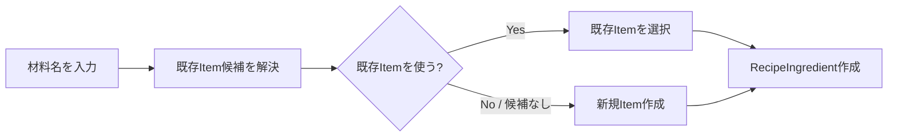
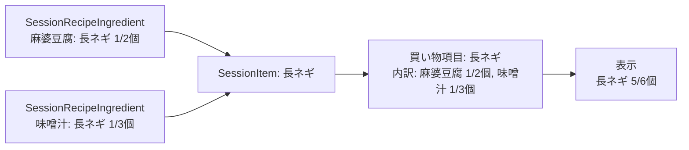
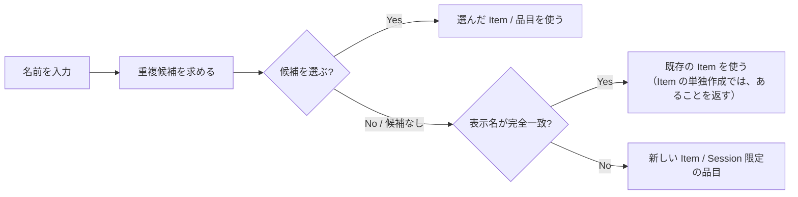

# RecipeDeck MVP 仕様

このファイルは RecipeDeck MVP の仕様の正本です。
設計・技術構成については [architecture.md](architecture.md) を参照してください。
Notion の要件ページや PoC ページと食い違う場合は、このファイルを優先します。
未確定事項を独断で補完せず、実装時に相談して決定します。
仕様に関わる変更をした PR では、このファイルも同じ PR で更新します。

> **過剰設計しないこと。**
> 将来起こり得る問題を先回りして、未要求の Entity・状態・Repository・履歴・分岐を追加しない。
> 将来の共有・同期・在庫・クラウド・undo などを理由に、不要な抽象化を追加しない。
> まず最小の自然なドメインを実装し、実際に必要になった責務だけ追加する。

## プロダクトの中核

RecipeDeck は、個別の買い物 Item を直接並べることを主目的とせず、**「何を作るか／何のために買うか」を起点に買い物リストを作成するアプリ**です。

代表フロー：

1. Recipe「麻婆豆腐」を登録する
2. Recipe に豆腐・長ネギ・ひき肉などを登録する
3. Recipe を今回の ShoppingSession へ追加する
4. 必要な Item を買い物リストとして表示する
5. 店頭で購入済みチェックを行う

MVP ではユーザー自身が所有する Recipe を前提とし、公開・共有・EC 連携などは対象外とします。
アカウント機能、複数端末間での共有・同期、および Web 版は MVP 以降に対応予定です。
なお、Web 版はオンライン専用を想定しています。

## 用語

| 呼び方 | コード上の名前 | 意味 |
|---|---|---|
| Recipe | `Recipe` | ユーザーが再利用する「作るもの」 |
| 材料 | `RecipeIngredient` | Recipe で、ある Item をどれだけ使うか |
| Item | `Item` | 買い物対象の同一性（ひき肉、豆腐、長ネギ） |
| 分量 | `Amount` | 数量と入力形式と、省略可能な単位の組 |
| 数量 | `Quantity` | 正の有理数 |
| 入力形式 | `QuantityNotation` | 数量を分数と小数のどちらで入力したか |
| 単位 | `AmountUnit` | 個・g・kg・ml・L |
| 倍率 | `Multiplier` | Recipe を Session に追加する際の倍率 |
| 下書き／利用可能 | `RecipeStatus.DRAFT` / `READY` | Recipe の状態 |
| ShoppingSession | `ShoppingSession` | 「今回の買い物」 |
| 進行中／完了 | `SessionState.Active` / `Completed` | ShoppingSession の状態 |
| Session 内の Recipe | `SessionRecipe` | Session に追加した Recipe のコピー |
| Session 内の材料 | `SessionRecipeIngredient` | Session 内の Recipe が、ある Item をどれだけ必要とするか |
| 品目 | `SessionItem` | Session の中の買い物対象1つ（買い物リストの1行の元）。表示名を持ち、Item から作ったものは Item へのつながりも持つ。Item（Session の外で登録する買い物対象）とは別のもの |
| Session 限定の品目 | Item へのつながりのない `SessionItem` | Item を作らず、Session の中にだけ表示名を持つ品目。Session と同じ寿命を持つ |
| 手動追加 | `ManualAddition` | Recipe を経由せず Session に直接追加した項目 |
| 今回は不要 | `SessionRecipeIngredient.isExcluded` | Recipe 本体は変更せず、今回に限り材料を除外すること |
| 買い物リスト | `ShoppingSession.toShoppingList()` | Session の中身から表示のたびに作る、品目ごとの一覧。保存しない |
| 買い物項目 | `ShoppingListItem` | 買い物リストの1行。SessionItem 1つにつき1つ |
| 内訳 | `ShoppingListItemSource` | 買い物項目に必要な分量の出どころ1件。Recipe 由来（`FromRecipe`）か手動追加（`Manual`）か |
| 購入済み | `ShoppingListItemSource.isPurchased` / `ShoppingListItem.isPurchased` | 内訳ごとに記録する。買い物項目は、除外していない内訳がすべて購入済みなら購入済み |
| 重複候補 | `DuplicateCandidate` | 名前を入力する場面で、同じものかもしれないとしてユーザーに示す既存の Item や Session の品目。選ぶかどうかはユーザーが決める（[Item 重複判定と AI](#item-重複判定と-ai)） |
| 購入の記録 | `PurchaseRecordRepository` | Session ごとの、購入済みの内訳の記録。ShoppingSession とは別の集約。domain にクラスはなく、この Repository が読み書きする |

## Recipe

ユーザーが再利用する「作るもの」です。

確定事項：

- 名前のみ必須（空白文字のみの名前は不可）
- 写真は任意
- メモは任意（説明欄は持たない）。空白文字のみのメモは、メモなし（null）として扱う
- 材料0件でも保存できる
- 人数（何人分か）の項目は持たない
- 状態は下書き（draft）／利用可能（ready）の2値。ユーザーが明示的に切り替えるものとし、材料数や写真の有無に基づく自動判定は行わない
- Recipe に登録された材料構成を1単位として扱う
- 同一の Item を1つの Recipe 内で複数行保持できる
- ShoppingSession へ追加する際に倍率を指定できる。倍率は正の有理数（1/4、1/2、1、2…）とし、選択肢は UI 側で提示・決定する
- 下書きの Recipe は ShoppingSession へ追加できない。UI は追加できない見せ方にし、UseCase でも拒む。材料0件でも、利用可能なら追加できる
- Recipe を編集しても、既に ShoppingSession へ追加済みの内容は変わらない（[ShoppingSession への Recipe 追加](#shoppingsession-への-recipe-追加)）

## Item

Recipe や ShoppingSession に所属しない、**買い物対象の同一性**を表す概念です。
例：ひき肉、豆腐、長ネギ。

確定事項：

- Item の同一性は内部 ID で表す
- 数量・単位・メモ・Recipe 内の並び順などは Item 本体に持たせない
- Recipe 由来か手動追加かで Item の種類を分けない
- Item の表示名変更（rename）と、異なる Item 同士の同一性統合（merge）は、別個の概念として扱う
- rename は Item の表示名を変え、その Item を使うすべての Recipe に効く。1つの Recipe だけで名前を変えたいときは、Recipe の編集で材料に別の表示名を入力する（既存の Item と一致すればその Item を使い、しなければ新しい Item を作る）
- rename で、前後の空白を除いた変更後の表示名が別の Item と完全に一致する場合は、表示名を変えず、その Item があることを返す。変える Item 自身の今の表示名と一致する場合は、変えたものとして扱う。2つの Item を1つにまとめるのは merge で、今は設けない（[未確定事項](#未確定事項)）
- AI の導入有無にかかわらず、Item というドメイン概念は変更しない
- Session で表示名を入力して足した品目（Recipe の追加時に今回だけ足した材料など）のうち、登録済みの Item と一致しないものは、Item を作らず、Session 限定の品目として Session の中にだけ持つ。Item の一覧や検索には出ず、Session を削除すれば一緒に消える。Session 限定の品目を Item として登録できるようにするかは、今後検討する（[未確定事項](#未確定事項)）
- 前後の空白を除いた表示名が、登録済みの Item と完全に一致する場合は、新しい Item を作らない
  - Item を単独で作る操作では、同じ表示名の Item があることを返す
  - Recipe の保存時に、材料として入力した表示名が一致した場合は、確認を挟まずに既存の Item を使う。既存の Item を使ったことは結果で返し、ユーザーへ知らせるかどうかは UI が決める
  - 同じ保存の中で、同じ新しい表示名を複数の材料に入力した場合も、Item は1つだけ作り、それらの材料が共通して参照する
  - Session への Recipe の追加で、材料として入力した表示名が一致した場合も、Recipe の保存時と同じく既存の Item を使い、使ったことを結果で返す。一致しなければ Session 限定の品目になる。同じ Session 内で、表示名が同じ Session 限定の品目は1つにまとめる（同じ品目とみなす条件は [ShoppingSession への Recipe 追加](#shoppingsession-への-recipe-追加)）
- 既存の Item は、表示名の部分一致で探す。見つかった Item は、完全一致、前方一致、それ以外の部分一致の順に並べ、同じ順の中では表示名の短いものを先にする
- Item は、Recipe や Session から使われていなくても単独で存在してよい。一方で、Recipe が使っている Item だけが消えることは避けたい（Item と Recipe とで寿命が異なる）

## 分量

数量と入力形式と単位の組です。
材料（RecipeIngredient）と Session 内の材料（SessionRecipeIngredient）が持ちます。

確定事項：

- 数量は正の有理数（約分済みの分子・分母）。0 および負数は数量として持てない（入力で 0 が来たときの扱いは[未確定事項](#未確定事項)）。1/3個のような端数を正確に保持し、合算や倍率計算で誤差を生じさせないため、小数値としては保持しない
- 数量の未指定は分量ごと省略して表す（0 として扱わない）
- 単位は「個」「g」「kg」「ml」「L」および「単位なし」。玉・束・本など対象物そのものを数える助数詞は「個」に統一する。ユーザー定義の単位は設けない
- パック・袋など容器を数える単位の扱いは未確定（[未確定事項](#未確定事項)）
- 数量なしで単位のみが存在する状態は許容しない。単位のみが入力された場合は分量なしとして扱う。このルールは分量（ドメイン）が持ち、入力を受け取る UseCase はそれを通して分量を作る
- 単位は入力された表記のまま保存し、自動換算は行わない（1000ml を自動で 1L に変換しない）
- 入力形式（分数表記か小数表記か）は、数値本体とは別の属性として保持する。値としては同じ 1/2 でも、ユーザーが「0.5」と入力したなら「0.5」と表示できるようにするため

## ShoppingSession

「今回の買い物」を表す単位です。

確定事項：

- 履歴として複数保持できる
- 進行中（active）の Session は最大1件。どう保証するかは [architecture.md](architecture.md#集約と不変条件) に書く
- 状態は active / completed の2種類。破棄する Session は履歴として残さず削除する
- completed な Session は過去の買い物実績として扱い、Session へコピーした内容（Recipe 名・Item の表示名・倍率・分量など）をそのまま保持する
- Session 内のデータは、Recipe や Item から独立したスナップショットとする。Session の外での操作（Item の表示名変更（rename）など）は、進行中・完了のどちらの Session にも反映しない。反映させたい場合は、通知やユーザーの選択を通す操作を別に設ける
- Session が持つ Item の ID は、Item の画面への移動など、利便性のためのつながりとして持つ。Session の表示や中身は Item に依存しない
- 作成日時と完了日時を保持する。完了日時を持つのは completed な Session のみ。作成日時は Session 作成時のタイムスタンプとする
- 材料の数量変更・「今回は不要」による除外・今回だけの材料の追加は、Recipe を Session へ追加する操作の中で行い、Recipe 本体には反映されない。除外した材料も Session 内に保持する（買い物リストでの見せ方は UI が決める）
- 追加した後に、Session 内の Recipe を単位として材料を編集できるようにするかは未確定（[未確定事項](#未確定事項)）
- Session 内の Recipe に今回限りで追加した材料と、Recipe からコピーした材料は区別しない（いずれも Session 内の材料として保持する）。一方、Recipe を経由せず Session に直接追加した分は、手動追加（ManualAddition）として区別して保持する
- 進行中の Session がないときに Recipe を追加すると、Session を自動で作る
- 同じ Recipe を複数回追加すると、追加のたびに別の Session 内の Recipe になる。同じ品目の分量は、買い物リストでは同じ買い物項目の内訳として並び、表示で合わせられる
- Session から、追加1回分の Recipe を単位として削除できる（必要になったときに実装する）。ただし買い物リスト表示の実装方式によっては不要になる可能性がある
- 買い物リスト上から Recipe を単位として追加する操作は、禁止はしないが今は設けない。買い物リスト上では、品目単位の数量変更・削除・追加を行う
- 追加後に倍率を変更する操作は MVP では提供しない
- 購入済みチェックは ShoppingSession に持たせない（[購入済みチェック](#購入済みチェック)）

## 材料の Item 参照

**保存済みの材料（RecipeIngredient）は Item を必ず参照する。**
「Item 未確定の材料」というドメイン状態は MVP では作らない。

未確定なのは、テキスト入力中や候補選択中の **UI / アプリケーション上の一時状態**であり、永続的なドメイン状態ではない。

Recipe の作成・編集では、材料ごとに「既存の Item」か「新しい表示名」を受け取り、新しい表示名の Item は Recipe の保存時に一緒に保存する。
Recipe の保存に失敗した場合は、そのとき作った Item も残さない。

材料の入力は、次のように扱う。

- 表示名も分量もない材料は、追加しかけてやめたものとして無視し、残りを保存する。単位だけが入力された材料も、分量なしとなるため同じ扱いとする
- 表示名がなく、分量がある材料は不正とし、何も保存せずに該当する材料の位置を返す
- 表示名があり、分量がない材料は、分量なしの材料として保存する

## ShoppingSession への Recipe 追加

Recipe を Session へ追加するとき、Session 側へ必要な情報をコピーする。
**追加後は ShoppingSession 側で完結する**。

- 元の Recipe を編集しても既存の Session には影響しない
- Recipe が後から変更・削除されても、進行中 Session の整合性を損なわない
- Session へコピーするのは、Recipe 名・Item の表示名・追加時の倍率・倍率適用後の分量
- Item から作った品目は、Item の表示名もコピーし、Item へのつながりとして ItemId を持つ。Session 限定の品目は、表示名だけを持つ
- Session 内で同じ品目とみなすのは、Item へのつながりと表示名がどちらも同じものだけとする。Item の表示名を変更した後に同じ Item を含む Recipe を追加すると、表示名が違うので別の品目になる
- 既存の Item を選んだ材料は、Item から表示名を写す。選んだ Item が見つからなければ、何も追加せずに該当する材料の位置を返す
- Session 内の材料は倍率適用後の分量を保持する。これにより、Session 内で数量を修正した際に、倍率適用前後のどちらの値を操作しているかが曖昧になるのを防ぐ
- 倍率を掛けた後の分量は、元の材料の入力形式（分数か小数か）を引き継ぐ
- 割り切れない値や長い小数の丸めは表示するときに行い、分量は分数のまま持つ。桁数と、打ち切りか四捨五入かは、表示を作るときに決める
- 元の Recipe ID は Recipe 画面への画面遷移用途でのみ保持し、それ以外の目的で Recipe を参照しない
- Session 内での変更を Recipe 本体へ反映する機能の検討時に、データ設計と合わせて見直す

## 買い物リスト表示

**買い物リストを永続化せず、Session の中身から表示のたびに作る。**

買い物リストは、Session 内の品目（SessionItem）ごとに1つの買い物項目を持つ。
買い物項目は、その品目を必要とする Session 内の材料を、すべての Session 内の Recipe から集めた内訳を持つ。
内訳の1件は、Recipe 由来なら Recipe 名・倍率・分量（倍率適用後、入力形式付き）・除外の有無、手動追加なら手動追加の分量である。どちらも購入済みかを持つ（[購入済みチェック](#購入済みチェック)）。
買い物項目は品目が初めて Session に入った順、内訳は Recipe を追加した順（同じ Session 内の Recipe の中では材料の順）に並べ、手動追加は内訳の最後に置く。

例：

- 麻婆豆腐 → 長ネギ 1/2個
- 味噌汁 → 長ネギ 1/3個
- 同じ品目であれば、買い物項目「長ネギ」が内訳 [麻婆豆腐 1/2個, 味噌汁 1/3個] を持ち、表示で合わせると長ネギ 5/6個

理由：

- 元のデータを正として扱える
- 二重管理を避けられる
- Item の統合や表示仕様の変更に追従しやすい
- MVP の規模であれば、表示ごとの集計でもパフォーマンス上の問題は生じにくい

同じ品目の分量を合わせて見せる（足す）のは表示で行い、買い物リストは内訳だけを持つ。
表示で足すときは、次の規則を守る。

- 除外した材料は数えない
- 数量の未指定を 0 として扱わない。足さずに、分量のない材料があることが分かるように残す
- 互換性のない単位を無理に1つの数量へ変換しない。今は単位を換算せず、同じ単位どうしだけを足す
- 足すと桁があふれる場合は、足さずに並べる
- 合わせた分量は入力形式（分数か小数か）を持たない。どちらで見せるかは表示で決める

足し方を、表示以外（買い物リスト上の品目単位の数量変更・削除など）が使うようになったら、domain に移す。

## 購入済みチェック

要件：

- 進行中の Session の買い物リストで、買い物項目を購入済み／未購入へ切り替えられる。内訳がすべて除外された買い物項目は、常に購入済みで切り替わらない（下記）
- オフラインで利用できる（Web 版はオンライン専用を想定するため除く）
- アプリを終了しても、端末を再起動しても失われない

**購入済みチェックは ShoppingSession（Session のスナップショット）に持たせず、別の集約（購入の記録）として持つ。**
Session の中身を変える操作（Recipe の追加など）と、店頭で続けて付けるチェックとが、互いの書き込みを消し合わないようにするためである（理由の詳細と見直す条件は [architecture.md](architecture.md#集約と不変条件)）。

- 購入済みかどうかは内訳ごとに、Session と内訳の ID の組で記録する
- 買い物項目が購入済みであるとは、除外していない内訳がすべて購入済みであること。買い物項目の購入状態は記録せず、内訳から導く
  - 購入済みの買い物項目に、同じ品目の材料を持つ Recipe を追加すると、新しい内訳は未購入なので、買い物項目は未購入になる。追加した Recipe のその品目の材料を除外していれば、購入済みのまま
  - 内訳がすべて除外された買い物項目は、購入済みになる。除外していない内訳が0件なので、条件を満たすため。見せ方は UI が決める（未確定事項）
- 買い物項目を購入済み／未購入にすると、その買い物項目の除外していない内訳を、まとめて同じ値にする。除外した内訳の記録には触れない。内訳を1件ずつ切り替える操作は、今は設けない
- 今ある Session の中身を変える操作（Recipe の追加）は、購入の記録に触れない。完了・削除や、除外・分量の変更などの操作で購入の記録をどうするかは、その操作を作るときに決める（未確定事項）
保存の方式は [architecture.md](architecture.md#データ層の方針) に書く。

## Item 重複判定と AI

**AI の採否によってドメインモデルを変更しない。**
AI / ML はドメインの中心に置かず、UseCase へ差し込める補助機能として扱う。
名前を入力する場面で、既存の Item や品目との重複候補をユーザーに示すかどうかだけの関心事として扱う。

重複の検知には、表示名の完全一致による検知と、AI による候補判定の2種類がある。
完全一致による検知は、仕組みとして確実に判定できるため、AI の有無にかかわらず行う。Recipe の保存や Session への Recipe の追加では、確認を挟まずに既存の Item を使い、Item を単独で作る操作と rename では、同じ表示名の Item があることを返す（[Item](#item)）。
AI による候補は完全一致より確度が一段落ちるため、完全一致とは扱いも見せ方も変える。
完全一致のように確認を挟まずに既存の Item を使うことはしない。

候補判定は、保存とは別の操作として行う。
UI は名前を入力する場面で候補を求め、ユーザーが候補を選べば、選んだ Item や品目を使う。
候補を選ばずに保存したときは、候補を求めなかったときと同じになる。Recipe の保存や Session への Recipe の追加では、表示名が完全一致すれば既存の Item を使い、一致しなければ新しい Item（Session への Recipe の追加では Session 限定の品目）になる。Item を単独で作る操作では、完全一致すれば同じ表示名の Item があることを返し、一致しなければ新しい Item を作る。rename では、別の Item と完全一致すれば同じ表示名の Item があることを返し、一致しなければ表示名を変える。
候補を入力中と保存時のどちらで求めるかは UI が決め、どちらでも保存の操作は変わらない。

候補を求める場面と、候補にするもの：

- Item の作成、Recipe の作成・編集の材料：既存の Item
- Session への Recipe の追加の材料：既存の Item と、進行中の Session の品目。同じ表示名の Item と品目がどちらも候補になる場合は、Item を候補にする
- Item の表示名変更（rename）：名前を変える Item 自身を除いた、既存の Item。候補の Item を選ぶことは2つの Item をまとめる（merge）ことになるので、merge を設けるまで、rename の候補は見せるだけで選べない

候補は確からしい順に並べた一覧で返し、何件を見せるかは UI が決める。候補がなければ空の一覧を返す。

候補から Session の品目を選んだときは、その品目に入る。ただし、今の Session への Recipe の追加の操作は、Session の品目を選んだことをまだ受け取れない。追加の画面を作るときに受け取れるようにする（それまでの挙動は [architecture.md](architecture.md#実装の進め方) の 13）。

rename は候補を選べないので、次の図には含めない（rename の規則は [Item](#item)）。

実装は機能フラグ（feature flag）等で ON / OFF を切り替えられる程度の疎結合を目指す。

### 暗黙的な自動統合（silent merge）は禁止

AI やルールベースの判定が高確度と評価した場合であっても、**自動的（暗黙的）に既存 Item へ統合（merge）してはならない**。
重複判定は次の用途にだけ使う。

- 候補の提示
- 候補の順位付け
- 明らかに別物の候補の抑制

既存 Item を選択するか新規 Item を作成するかは、最終的にユーザーの明示的な操作によって決定する。

なお、Recipe の保存時や Session への Recipe の追加時に、表示名が完全一致した材料を既存の Item に結び付けることは、異なる Item ID 同士の統合（merge）ではない（[Item](#item)）。
新しい Item を作らずに済ませるだけであり、この禁止の対象には当たらない。

## 別名（Alias）と既知知識

Item の同一性には、複数の表記（surface）を関連付けられる余地を持たせる。
例：玉ねぎ、玉葱。

ただし、別名（alias）の文字列から Item を常に1対1で決めてはいけない。
例えば「さけ」は「酒」と「鮭」のどちらも指しうる。
そのため概念上は、正規化した表記から複数の Item 候補を引ける余地を残す。
候補が複数存在する場合は「酒／鮭のどちらですか」のようにユーザーへ選択を促す。
既知の別名（alias）で解決できるケースが増えるほど、AI 推論を呼び出す必要性は低減する。

別名（alias）の具体的な Entity 構造、データソースの種別、永続化形式は現時点では未確定とし、必要性が生じた段階で最小限の構造を設計する。

## SAME / NOT_SAME / AI 判定の整理

過去の PoC の SAME_HIGH_CONFIDENCE / UNKNOWN などは**実験上のラベル**であり、そのまま MVP のドメイン型に持ち込まない。
MVP で実用上必要なのは、次の導線である。

- 既知の安全な候補
- 通常の類似候補
- 明示的に抑制すべき候補
- ユーザーが最終的に既存 Item を選ぶ／新規 Item を作る

「UNKNOWN」という永続的なドメイン状態を新設しない。

## 表示名変更（Rename）と同一性統合（Merge）

- Rename：同じ Item ID の表示名を変更する操作。rename 時にも通常の重複判定 UseCase を接続してよい
- Merge：異なる Item ID を同じ Item として扱う操作。rename 時に既存 Item との重複が見つかった場合、必要なら merge 処理へ接続できる
- 今は merge を設けない。rename で別の Item と表示名が一致したときは、変えずにその Item があることを返すだけにする（[Item](#item)）
- merge を設けるときも、rename で一致したら自動ではまとめず、ユーザーの確認を通してから merge に繋ぐ（[暗黙的な自動統合（silent merge）は禁止](#暗黙的な自動統合silent-mergeは禁止)）。rename の候補から Item を選んだときも同じ

**AI の採否によって merge の設計を根本から変えない。**
AI の応答が遅い場合や利用しない場合は、該当 UseCase への重複判定機能の接続を無効化すればよい。

## 未確定事項

実装開始前にすべてを確定させるのではなく、UseCase を順次実装していく中で具体的に必要性が生じた段階で相談・決定する。

- 表示で分量を合わせるときの単位の表し方（g と kg を換算して揃えるか、「1L + 1000ml」のように単位ごとに並べるか）。今は換算しない。実際に動作させながら決める
- 表示で合わせた分量を、分数と小数のどちらで見せるか。表示を作るときに決める
- 数量に 0 が入力されたときの扱い（分量なしとみなすか、不正とするか）
- 数量と倍率の入力の上限（桁数など）。今は上限を設けない。守るのは正の有理数であることだけで、計算で桁があふれる場合の扱いは、表示で足すとき（[買い物リスト表示](#買い物リスト表示)）は決まっており、倍率の計算（architecture.md の「実装の進め方」の 10）は未確定。常識的な範囲を、入力 UI を作るときに決める
- パック・袋など容器を数える単位の扱い。同一の Item で「1個」と「1パック」が混在する場合、単純に「個」へ統一すると、表示で合わせるときに誤って足されてしまう問題がある。表示で分量を合わせるときの単位の表し方と合わせて方針を決定する
- 空の Session（Session 内の Recipe も手動追加も1つもない Session）を有効な状態とするか。Recipe の追加では空の Session は生まれない（材料0件の Recipe を追加しても、Session 内の Recipe が1つ入る）。「買い物リストの作成」のように Session を先に作る操作を設けるかは、その画面を作るときに決める
  - `ShoppingSession.create` は空の Session を返すが、今は Recipe の追加で `withAddedRecipe` と組み合わせてだけ使い、空のまま保存する操作はない。`create` があることは、空の Session を有効とする決定ではない
- Session への Recipe の追加で、今回だけ足した材料にも倍率を掛けるか。今の想定は、掛けられるようにする（選択肢の一つで、確定ではない）。倍率を掛けるのは追加の画面で、UseCase は掛け終えた分量を受け取るので、どちらに決めても UseCase は変わらない。追加の画面を作るときに決める
- Session への追加の画面を開いた後に、元の Recipe が編集された場合（材料・名前・状態の変更）の扱い。画面に出している材料と、保存のときに読む Recipe の名前・状態が食い違いうる。追加の画面を作るときに決める
- 追加した後に、Session 内の Recipe を単位として材料を編集できるようにするか。除外した材料を後から有効に戻せるようにするかも合わせて決める
  - 除外を戻す操作を作るとき：今の記録の仕組みのままだと、購入済みの内訳を除外して戻せば、購入の記録が残っているので購入済みで戻る。それでよいか、除外したときにチェックを外すかを決める
  - 分量を変える操作を作るとき：既定では購入済みを変えない。変える場合は、編集の UseCase に入れるビジネスルールとして決める
- 手動追加の操作を作るとき、同じ品目に手動追加を繰り返したらどうするか。今の想定は、手動追加を1回するたびに、その品目の内訳を1行増やす。1つの Recipe に同じ品目の材料が複数行あるとき、それぞれが別の内訳になるのと同じ扱いにする
  - 牛乳 1本を2回足すと、内訳が2行（1本、1本）になり、表示で合わせて 2本に見える。単位が違えば、表示の規則どおり足さずに並ぶ（[買い物リスト表示](#買い物リスト表示)）
  - 足した行は新しい内訳なので未購入になり、その品目が購入済みだったら未購入になる（Recipe を追加したときと同じ。[購入済みチェック](#購入済みチェック)）。購入状態が変わったことは、Snackbar などでユーザーに知らせる
  - 今の構造では、手動追加は品目ごとに0か1つ（[architecture.md](architecture.md#ドメイン構造)）なので、この想定とは合わない。手動追加の操作を作るときに、構造を見直す
  - 追加の画面からでも、買い物リストの編集からでも同じことができるので、どちらからも ShoppingSession の同じ操作に行き着くようにする
- Session から Recipe を外す操作を作るとき、外した内訳の購入の記録を消すか。残しても、その内訳はもう買い物リストに現れないので、表示は変わらない
- 完了した Session の購入の記録をどうするか。今の考えは、そっくりそのまま残す。完了した Session でチェックを切り替えられるようにするかも合わせて決める（今の操作は進行中の Session だけを対象にする）。Session を削除するときは、その Session の購入の記録も Session の ID でまとめて消す考え。完了・削除の操作を作るときに決める
- 買い物リストを Recipe 単位と品目単位の2つの見せ方で切り替えられるようにするか。品目単位では品目を1行にまとめ、展開すると内訳ごとに並べ、Recipe 単位では同じ品目が複数の Recipe に点在する。作るときは内訳を1件ずつ購入済みにする操作を足せばよく、購入の記録は内訳ごとなので保存の形は変えなくてよい。一部の内訳だけ購入済みのとき、合計ではなく残りの分量を見せるかもそのときに決める。UI を作るときに決める
- 内訳がすべて除外された買い物項目（[購入済みチェック](#購入済みチェック)）に、チェック欄を出すかなどの見せ方。UI を作るときに決める
- 同一の Item を1つの Recipe 内で複数行保持できる仕様（[Recipe](#recipe)）を見直すか。見直しても、購入済みチェックへの影響はほぼない（内訳の ID は行ごとに持つ）
- 買い物リスト上で品目単位に数量を変える・削除するとき、その買い物項目に内訳が複数あったら（複数の Recipe や手動追加から分量が来ていたら）、どの内訳をどう変えるか。今のドメインには、買い物項目単位の変更を表す場所がない。リストの編集を作るときに決める
- Session 限定の品目を Item として登録できるようにするか。今は Item にしない。設ける場合は、ユーザーに Item として登録するかを尋ねる導線とし、登録しない選択肢も残す。登録したときは、その SessionItem に登録した Item へのつながりを持たせれば、Session 内の材料の行はそのまま使える。ただし、同じ Item へのつながりと同じ表示名を持つ品目が既に Session にある場合の扱い（まとめるか）は、そのときに決める
- Session 限定の品目がある Session で、同じ表示名の Item が後からできた場合（作成のほか、rename で同じ表示名になった場合も）、その後の追加で Item を指す行と Session 限定の品目が同じ名前で並ぶ。今は許容する。追加のたびに Session 限定の品目も既存の Item と照らし直す対応を後から足せる（足した時点で完了済みの Session は直らない）。足す場合も、既存の品目の Item へのつながりを変えることになるので、自動では変えず、通知やユーザーの選択を通す（[ShoppingSession](#shoppingsession) の方針）
- MVP に merge を含めるか。今は設けない（rename で別の Item と一致したら、変えずに知らせるだけ）。重複した Item がどのくらいできるかを、UI と重複候補の判定の具象を作って使ってから決める
  - merge を設けるときは、下の旧 Item ID の扱いと Item の削除に加え、Session の品目が持つ旧 Item へのつながりを、まとめた先の Item に付け替えるかも決める。品目の表示名はスナップショットなので変えない（[ShoppingSession](#shoppingsession)）
- 統合（merge）後の旧 Item ID の扱い（redirect / tombstone、undo を含む）
- Item の削除を提供するか。提供する場合、Recipe から使われている Item をどう扱うか。Session は表示名を持つので、Item を削除しても Session の中身は変わらない。あわせて、Recipe の保存時に、材料で選ばれた既存の Item が存在するかを確かめるかも決める（現時点では、削除の手段がないため確かめていない。Session への Recipe の追加では、表示名を写すために確かめている）

## 参照

背景資料です。
このファイルと食い違う場合は、このファイルを優先します。

- [買い物アプリ 要件定義（たたき台）](https://app.notion.com/p/3eb36b11d5ed81d39f61c48938e32b16)
- [MVP ドメイン・ユースケース設計（議論ログ）](https://app.notion.com/p/3ec36b11d5ed8153bad3f9972c835cee)
- [オンデバイス材料正規化 PoC](https://app.notion.com/p/3ec36b11d5ed81bc9e8afb2220965324)
- [Item 同一性判定 PoC](https://app.notion.com/p/3ec36b11d5ed8103880cc354f4217c14)
- [Safety-first Item 重複判定 PoC](https://app.notion.com/p/3ec36b11d5ed810c9934e5edceee4e21)
